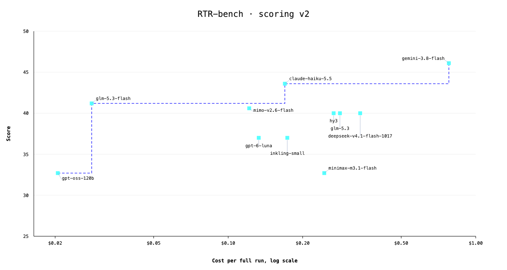

# RTR-bench

**RTR-bench** tests whether language models can predict how a crowd interprets an ambiguous prompt. It investigates one aspect of cultural fluency: anticipating how people assign meaning to words, people, institutions, and ideas. Its source is [Mixed Messages](https://mixedmessages.fyi), a generative art project where participants respond to a daily prompt by placing a coordinate on a 2×2 grid: Honest vs Performed on one axis, Uniting vs Dividing on the other. The dataset used here contains 39,828 submissions across 165 closed windows.

These submissions were collected through participation in a generative art project. Participants were not trained to apply an annotation rubric or converge on a correct answer. Each placement recorded an interpretation, and together those placements formed a distribution. That distribution preserves both agreement and disagreement: how strongly one reading prevailed, which alternatives attracted people, and where the crowd split.

Commonly cited benchmarks such as [HLE](https://lastexam.ai/) and [SWE-bench](https://www.swebench.com/) evaluate expert answers or software changes against defined criteria for success. RTR-bench evaluates a model against an observed social response. A crowd’s interpretation can be contradictory, unfamiliar, or difficult to anticipate, and accurately predicting it requires distinguishing what a prompt means to that audience from the reading the model would otherwise produce.

For each prompt, the model answers two separate questions: which of the four quadrants received the most human submissions, and which quadrant represents its own interpretation. Both responses are compared with the recorded crowd response. The headline score measures how often the model correctly predicts a quadrant with the most crowd submissions, accepting either when the crowd ties. This gives a straightforward measure of agreement, although it captures only part of the underlying distribution.

The score is one way to compare models; their patterns of agreement and error are another. Which interpretations do models consistently anticipate? Where do different models make the same mistake? How does asking a model to predict the crowd change its answer? RTR-bench uses these questions to examine what it means for a model to read the room - with the room here defined by the participants in Mixed Messages.

## How it works

[Mixed Messages](https://mixedmessages.fyi) publishes one prompt, every day. Over a 24-hour submission period, participants interpret that prompt by placing a coordinate on the grid. When the window closes, a rendering algorithm uses the (x, y) coordinates to create an artwork which depicts the day's collective interpretation. Each window has one or more leading quadrants, along with conviction and polarization scores. The 2x2 grid gives us four possible options for the dominant quadrant, with the following implied readings and coordinates:

| Quadrant | Reading | Coordinates | Color |
|---|---|---|---|
| Honest x Uniting | Bringing us together, authentically | x ≥ 5,000, y < 5,000 | Green |
| Honest x Dividing | Fracturing us, truthfully | x ≥ 5,000, y ≥ 5,000 | Purple |
| Performed x Uniting | Creating false unity among us | x < 5,000, y < 5,000 | Cyan |
| Performed x Dividing | Exploiting our divisions, deliberately | x < 5,000, y ≥ 5,000 | Red |

**The dataset.** 39,828 submissions across 165 of the 174 closed windows, as of November 12th. Only windows with at least 25 submissions are included. `data/windows.json` holds everything: the prompt, the submission counts by quadrant, the center of mass, and the conviction and polarization scores, which are not used in scoring but may be included at a later date.

**The task.** For each window with N≥25 submissions, the model is asked to determine, given the prompt, which quadrant received the most submissions. Submission counts and dominant quadrants are never shown to the model.

**Scoring (v2).** A prediction receives one point if it selects any quadrant with the most crowd submissions, and zero otherwise. The score is the percentage of evaluated prompts predicted correctly. Three of the 165 windows have tied crowd winners: Republicans, Police Departments, and Freedom. Either co-winning quadrant is accepted for those windows.

Each question is asked four times with cyclically rotated option orders. A unique modal answer becomes the final answer: 4–0, 3–1, and 2–1–1 are resolved; a 2–2 or four-way vote tie has no final answer and scores zero. If some responses are missing or invalid, a unique mode among the remaining valid responses is retained and the window is flagged as incomplete. An attempted window with no valid response scores zero. Limited runs evaluate only the windows attempted.

**Consistency.** Each model also receives a separate 4/4 consistency percentage for each question: the fraction of attempted windows with four valid matching answers. Reports distinguish the other vote patterns from incomplete or missing responses. Consistency does not change the headline score. These measurements compare different option orders; identifying how much variation is caused by order requires a separate experiment that repeats identical prompts under the same settings.

Scoring v2 was recalculated from the original saved responses; the eleven models were not retested. [Scoring-v1 reports](results/history/scoring-v1/) preserve the earlier results. See the [results guide](results/README.md) for metric definitions. The question wording, dataset, and raw responses are unchanged.

## Quickstart

You need Node.js 18 or newer and an OpenRouter API key with available credits. The published package includes the benchmark dataset; no repository setup is required. Scoring v2 is available in this source checkout; npm version 0.1.5 uses scoring v1. Use the [Development setup](#development) to reproduce the v2 results until a newer package is published.

Create a folder for your results, add your API key, and run a model:

```bash
mkdir rtr-run && cd rtr-run
echo 'OPENROUTER_API_KEY=sk-or-your-key' > .env
npx --yes rtr-bench@latest z-ai/glm-5.3-flash
```

Replace `sk-or-your-key` with your OpenRouter API key. To evaluate another model, replace `z-ai/glm-5.3-flash` with its OpenRouter model ID. `npx` downloads and caches the package automatically; `--yes` skips its install prompt.

The command runs the benchmark, prints the score, and saves responses, scores, and a report in `results/`. A full run schedules 1,320 calls: two questions, each asked in four option orders, across 165 prompts. Retries can add calls. Time and cost depend on the model and provider.

To list available model IDs and token prices:

```bash
npx --yes rtr-bench@latest catalog --limit 20
```

To try the command on just five prompts before running the full benchmark:

```bash
npx --yes rtr-bench@latest z-ai/glm-5.3-flash --limit 5
```

This smaller run checks your setup; its score is not comparable with the full benchmark results. Rerunning without `--limit 5` reuses completed responses and runs the remaining prompts.

## Results

| Model | Provider | Score (v2) | Cost | Own reading 4/4 |
|---|---|---|---|---|
| z-ai/glm-5.3-flash | Tenstorrent (fp8) | 41.2 | $0.0281 | 37.0% |
| z-ai/glm-5.3 | Tenstorrent (fp8) | 40.0 | $0.2828 | 35.2% |
| minimax/minimax-m3.1-flash | GMICloud (fp8) | 32.7 | $0.2444 | 18.2% |
| xiaomi/mimo-v2.6-flash | GMICloud (bf16) | 40.6 | $0.1216 | 25.5% |
| deepseek/deepseek-v4.1-flash-1017 | Morph (fp8) | 40.0 | $0.3414 | 44.2% |
| tencent/hy3 | Tencent (fp8) | 40.0 | $0.2667 | 40.6% |
| google/gemini-3.8-flash | Google AI Studio | 46.1 | $0.7790 | 54.5% |
| openai/gpt-6-luna | OpenAI | 37.0 | $0.1329 | 50.3% |
| anthropic/claude-haiku-5.5 | Claude Platform on AWS | 43.6 | $0.1694 | 58.2% |
| thinkingmachines/inkling-small | DeepInfra (fp8) | 37.0 | $0.1733 | 16.4% |
| openai/gpt-oss-120b | DekaLLM (bf16) | 32.7 | $0.0205 | 64.2% |



See the [results guide](results/README.md) for the saved outputs and [models' own interpretations](results/interpretations.md) for each prompt. Open `results/interpretations.html` locally to search prompts and select a model/provider run.

Eleven models were tested against the same 165 windows, representing 39,828 human submissions. Scores ranged from 32.7 to 46.1, compared with a 31.5 baseline for always choosing the most common quadrant and 33.9 for a simple lexical heuristic. Gemini scored highest, correctly predicting 76 of the 165 windows. Its bootstrapped 95% confidence interval was 38.2–53.3%, however, so small differences between models should be treated cautiously. Uniformly guessing a final quadrant gives a 25.5% baseline when crowd co-winners are accepted.

Perhaps the value of the benchmark lies more in exposing model behavior than in actually ranking models. As described above, benchmarks such as HLE and SWE-bench evaluate whether a model can answer an expert question or resolve a software issue against defined criteria. RTR-bench asks whether a model can anticipate how a particular crowd interpreted something ambiguous. An incorrect prediction does not establish that the model’s interpretation is unreasonable. It shows where that interpretation departs from the room.

The clearest shared departure was Honest × Dividing. This was an outright or tied crowd winner in 42 of 165 windows, or 25.5%. Across the models’ 1,591 final predictions without a tie between option orders, however, they selected it only 160 times, or 10.1%. Across model–prompt cases where Honest × Dividing was an outright or tied crowd winner, models selected it 15.2% of the time, compared with 60.7% for Honest × Uniting. Unresolved model votes count as misses in these figures. The models were much better at anticipating authentic unity than anticipating division that participants interpreted as honest.

Donald Trump and Elon Musk illustrate both the pattern and the limits of the current score. None of the eleven models correctly predicted the dominant quadrant for either Trump’s window or either of Musk’s two windows. For Trump, 634 of 738 submissions—85.9%—landed in Honest × Dividing. In the first Musk window, the same quadrant won with only 278 of 720 submissions, or 38.6%, narrowly ahead of Performed × Dividing at 34.7%. Both count as an incorrect prediction, although one misses an overwhelming consensus and the other misses a closely divided crowd. At the other end, all eleven models correctly predicted Handwritten Notes, The CIA, and Altruism.

Across the 1,815 model–prompt cases for the own-reading question, 733 (40.4%) produced four matching valid answers. Another 598 (32.9%) split 3–1. The consistency columns and full vote-pattern report make that variation visible separately from agreement with the crowd. These results do not by themselves establish how much of the variation comes from option order versus variation between otherwise identical calls.

These results return to what makes the source data unusual: the crowd’s answer is a distribution. The current score reduces that distribution to its leading quadrants, making comparison straightforward while leaving much of the disagreement unmeasured. My main takeaway is that these models share a difficulty anticipating when this audience reads division as honest. Establishing how broadly that pattern holds will require more audiences, prompt variants, and future windows. Next, I would like to test more frontier models, report performance separately where the crowd was decisive, and evaluate predictions of the full distribution alongside the dominant-quadrant score. Conviction and polarization could then help describe the kinds of disagreement a model understands, and the kinds it consistently misreads.

## Optional usage

OpenRouter may route calls to different providers serving the same model. To list providers, token prices, and numerical precision:

```bash
npx --yes rtr-bench@latest providers z-ai/glm-5.3-flash
```

To use a specific provider, add `--provider` with a name from that list:

```bash
npx --yes rtr-bench@latest z-ai/glm-5.3-flash --provider Wafer
```

A pinned run refuses to fall back to another provider, and the summary names the providers that served the calls. Provider availability can change.

The default is six concurrent calls. To allow up to eight calls at once, add `--concurrency 8`. This may shorten the run if the provider's rate limits allow it.

## Development

To modify the benchmark or run the repository's source code, use the setup below. These commands run TypeScript directly and require Node.js 22.18 or newer.

```bash
git clone https://github.com/1999labs/RTR-bench
cd RTR-bench
npm install
echo 'OPENROUTER_API_KEY=sk-or-your-key' > .env
node src/cli.ts z-ai/glm-5.3-flash
```

Replace `sk-or-your-key` with your OpenRouter API key. The run automatically generates scores and a report in `results/`.

Rebuilding the dataset requires the project's database connection and the configuration in `scripts/export.mjs`. The exported dataset is already included, so running the benchmark does not require database access.

## License

MIT for the code. CC0 for `data/windows.json`.
