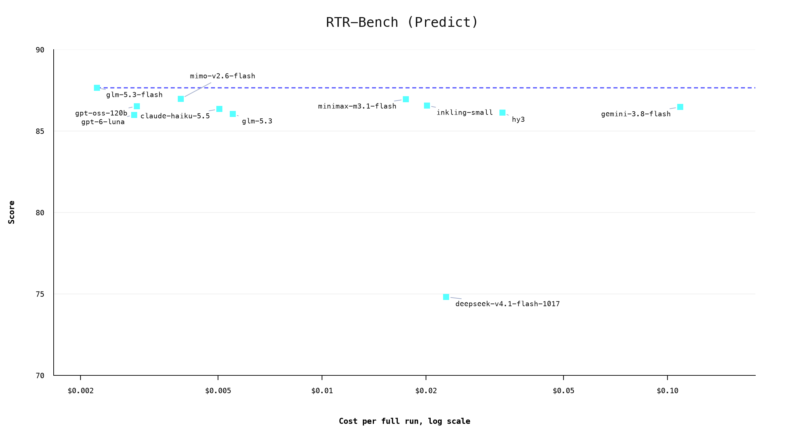
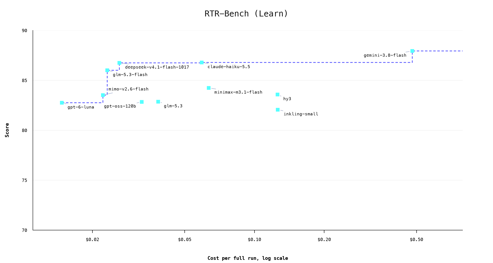
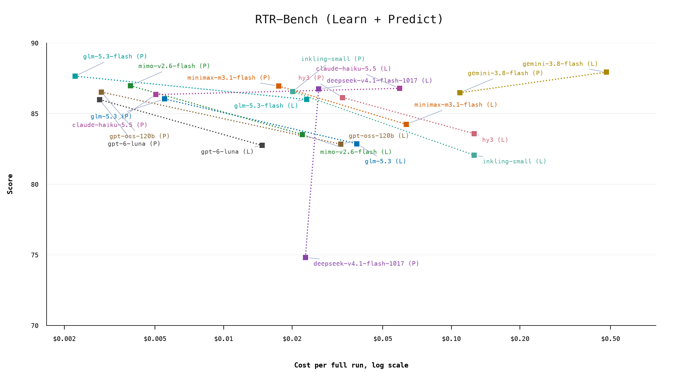

# RTR-bench

**Can a model learn how a particular audience interprets the world?** RTR-bench evaluates predictions of audience interpretations using responses collected by [Mixed Messages](https://mixedmessages.fyi), a generative art project. Participants place a coordinate on a two-axis grid in response to a daily word or phrase. The axes are **Honest ↔ Performed** and **Uniting ↔ Dividing**.

This release contains **165 prompt windows representing 39,828 submissions**. One row is one aggregate prompt window, not one person or submission. The outcomes describe the Mixed Messages audience, not objectively correct meanings or a representative sample of the general population.

**Predict** tests whether a model can predict the audience's response without examples. **Learn** lets it choose and inspect up to three historical examples before making the same prediction. Both return four probabilities and receive a distribution score out of 100. **Learn Gain = Learn score − Predict score** shows whether the complete evidence-gathering workflow helped.

[Code and CLI](https://github.com/1999labs/RTR-bench) · [Predict protocol](https://github.com/1999labs/RTR-bench/blob/main/docs/distribution.md) · [Learn protocol](https://github.com/1999labs/RTR-bench/blob/main/docs/learn-room.md) · [Verified final results](https://github.com/1999labs/RTR-bench/tree/main/results/final-8000)

## The two tests

### Predict

The model receives a target word or phrase, a description of the audience, and the four quadrant definitions. It predicts the fraction of audience responses in each quadrant, without historical examples or target outcomes. For example:

```json
{
  "performed+uniting": 0.10,
  "honest+uniting": 0.50,
  "performed+dividing": 0.25,
  "honest+dividing": 0.15
}
```

These are proportions, not a single winning label or the model's own preference.

### Learn

The model receives the same prediction task, but can gather evidence first:

1. Request a catalog of the **90 reference prompt names and IDs**, without their outcomes.
2. Choose a reference to inspect, revealing its quadrant distribution and submission count.
3. Use that observation to choose another reference, up to **three distinct inspections**, or stop early.
4. Submit four probabilities for the target, summing to one.

Each target starts a fresh conversation. The model receives no target score or correctness feedback, and nothing carries over to the next target. Learning happens through the conversation; model weights are not updated. The environment permits eight actions and eight model turns.

The public CLI uses the `transfer-check-v1` policy: assess whether each example transfers on each axis and discount weak analogies. Predict and Learn default to **8,000 output tokens per response** in the current release. Record the model, provider, policy, token allowance, and other settings when reporting results.

Random-example and text-similarity conditions are optional comparison controls, not additional tracks. Similarity uses a frozen lexical TF–IDF method. Learn Gain measures the whole workflow, including example selection, additional inference, and answer completion; it does not isolate the causal effect of examples alone.

### Original winning-quadrant benchmark

The earlier RTR benchmark predicts a winning quadrant using cyclic answer orders. Its score is percentage accuracy over all 165 windows and is **not comparable** to the new distribution scores. Its [archived results and protocol](https://github.com/1999labs/RTR-bench/tree/main/results/history/original-benchmark) remain available. Predict and Learn use the frozen 90/30/45 partitions below.

## Data and collection

The source snapshot was exported on **2026-11-12 at 06:20:26 UTC**. It includes closed Mixed Messages windows among days 1–174 that have at least 25 submissions: 165 windows with an observed minimum of 44, median of 192, and maximum of 1,163 submissions. The other nine days are excluded by the source snapshot's inclusion rule. Day numbers are project window IDs, not calendar dates.

Every recorded mark in an included window contributes to its counts. Participants were not trained annotators and were not instructed to converge on a correct answer. This release does not provide respondent demographics, unique-person counts, or individual-level placements. It contains aggregate counts, distributions, and summary measures only. No participant identifiers or wallet addresses are included in the row export; the original source metadata includes the public project contract address.

| Canonical quadrant | Audience reading | Source count key | Original coordinate rule |
|---|---|---|---|
| `performed+uniting` | Creating false unity among us | `tl` | x < 5000, y < 5000 |
| `honest+uniting` | Bringing us together, authentically | `tr` | x ≥ 5000, y < 5000 |
| `performed+dividing` | Exploiting our divisions, deliberately | `bl` | x < 5000, y ≥ 5000 |
| `honest+dividing` | Fracturing us, truthfully | `br` | x ≥ 5000, y ≥ 5000 |

## Frozen splits

| Hugging Face split | Days | Rows | Intended use |
|---|---|---:|---|
| `reference` | Included days 1–99 | 90 | Historical evidence pool and constant baseline |
| `development` | 100–129 | 30 | Implementation and prompt development |
| `evaluation` | 130–174 | 45 | Evaluation after settings are frozen |

There is **no training split** in this protocol. All reference windows precede all targets. The boundaries were chosen by chronology, not crowd labels. Both Elon Musk windows (days 30 and 99) remain in reference. The split manifest records entity grouping and the dataset fingerprint.

**Target labels are public in these files for scoring, but must not be passed into model prompts or unrestricted agent retrieval.** Only the reference catalog and permitted inspected reference outcomes may enter the agent's context. Development outcomes never become reference evidence. Loading a dataset row is not itself a compliant evaluation environment; use the linked runner to enforce that boundary.

The data were public and used in the original RTR benchmark before these new partitions were defined. The final split has now been evaluated with multiple models. It is a holdout from the declared development process, not a claim of unseen model training data. Any later tuning informed by these outcomes must disclose that exposure.

## Loading

Load all three splits with Hugging Face Datasets:

```python
from datasets import load_dataset

room = load_dataset("noahmclaughlin/RTR-bench")
reference = room["reference"]       # 90 rows
development = room["development"] # 30 rows
evaluation = room["evaluation"]   # 45 rows
```

For the original 165-window benchmark, concatenate the three splits in chronological order:

```python
from datasets import concatenate_datasets

all_windows = concatenate_datasets([
    room["reference"], room["development"], room["evaluation"]
])
```

Pin a Hugging Face commit with `revision="<dataset-commit>"` when publishing results. The human-readable JSONL files also work without the Datasets library. The byte-identical original source and split manifest are included under `source/` for compatibility with the Node.js runners.

## Row schema

| Field | Type | Meaning |
|---|---|---|
| `id` | string | Stable window ID, e.g. `mm-001` |
| `day` | integer | Original Mixed Messages window ID |
| `prompt` | string | Original prompt text, preserving case |
| `partition` | string | `reference`, `development`, or `evaluation` |
| `submission_count` | integer | Number of recorded marks in this window |
| `count_performed_uniting`, `count_honest_uniting`, `count_performed_dividing`, `count_honest_dividing` | integer | Four nonnegative counts, summing to `submission_count` |
| `share_performed_uniting`, `share_honest_uniting`, `share_performed_dividing`, `share_honest_dividing` | float | Corresponding count divided by `submission_count`, without display rounding |
| `winning_quadrants` | list of strings | All canonical quadrant labels tied for the maximum count |
| `winning_share` | float | Maximum count divided by `submission_count` |
| `centroid_x`, `centroid_y` | float | Original rounded mean coordinates, normalized to approximately [0, 1] |
| `conviction` | float | Original rounded mean distance from the grid center, divided by 7071 and multiplied by 100 |
| `polarization` | float | Original rounded RMS distance from the centroid, divided by 7071 and multiplied by 100 |

There are three crowd-winner ties: Republicans (day 60), Police Departments (68), and Freedom (83). The original source contains a legacy single winner and rounded winning share; this export derives **all co-winners and full-precision shares from integer counts**. Conviction, polarization, and centroid fields are descriptive and do not enter the current scores.

## Scoring Predict and Learn

For target probabilities `p` and observed shares `y`, the error is the sum of `(p[q] - y[q])²` over the four quadrants. Average errors equally across declared targets, then compute:

```text
score = 100 × (1 − mean_error / 2)
Learn Gain = Learn score − Predict score
```

A score of 100 is an exact distribution match. These scores are **not percentage accuracy**, and 50 is not a chance baseline. Report uniform and constant-reference predictions on the same targets. The constant baseline averages the 90 reference-window distributions equally, rather than pooling their submissions.

Predictions must contain exactly the four canonical keys and finite numbers between zero and one. Sums within 0.001 of one are normalized; other invalid or missing terminal predictions receive zero and remain in the denominator. Pending targets keep a run incomplete. Saved requests, responses, costs, and traces support offline replay. The protocol documents the bounded transport retries and agent action recovery rules.

## Results

<!-- FINAL_RESULTS_START -->
All eleven models use the same 45 evaluation targets and 8,000-token response allowance. Scores measure distribution agreement, not percentage accuracy. Counts show valid answers; failed terminal answers score zero and were not rerolled. [Verification, intervals, and raw records](https://github.com/1999labs/RTR-bench/tree/main/results/final-8000).

| Model | Provider | Predict | Predict Cost | Learn | Learn Gain | Learn Cost | Total Cost |
|---|---|---:|---:|---:|---:|---:|---:|
| Historical-average baseline | No model | 85.56 | — | 85.56 | — | — | — |
| glm-5.3-flash | Relace (fp4) | 87.66<br>45/45 valid | $0.00223 | 86.00<br>45/45 valid | −1.66 | $0.02315 | $0.03363 |
| glm-5.3 | Wafer (fp4) | 86.04<br>44/45 valid | $0.00551 | 82.87<br>44/45 valid | −3.17 | $0.03842 | $0.05741 |
| minimax-m3.1-flash | Inferact vLLM (nvfp4) | 86.95<br>45/45 valid | $0.01748 | 84.24<br>45/45 valid | −2.71 | $0.06345 | $0.11698 |
| mimo-v2.6-flash | Xiaomi (fp8) | 86.98<br>45/45 valid | $0.00390 | 83.53<br>45/45 valid | −3.45 | ≥$0.02217 | ≥$0.04005 |
| deepseek-v4.1-flash-1017 | Sail Research (fp4) | 74.82<br>38/45 valid | ≥$0.02286 | 86.75<br>45/45 valid | +11.93 | ≥$0.02614 | ≥$0.10495 |
| hy3 | Tencent (fp8) | 86.14<br>45/45 valid | $0.03331 | 83.58<br>45/45 valid | −2.56 | $0.12577 | ≥$0.27726 |
| gemini-3.8-flash | Google AI Studio | 86.48<br>45/45 valid | $0.10883 | 87.94<br>45/45 valid | +1.46 | $0.47906 | $0.89724 |
| gpt-6-luna | OpenAI (Flex) | 85.99<br>44/45 valid | $0.00286 | 82.75<br>44/45 valid | −3.24 | $0.01475 | $0.02883 |
| claude-haiku-5.5 | Anthropic | 86.35<br>45/45 valid | $0.00504 | 86.79<br>45/45 valid | +0.44 | $0.05925 | $0.07958 |
| inkling-small | DeepInfra (fp4) | 86.57<br>45/45 valid | $0.02011 | 82.06<br>44/45 valid | −4.51 | $0.12605 | $0.22916 |
| gpt-oss-120b | DekaLLM (bf16) | 86.53<br>45/45 valid | $0.00291 | 82.84<br>45/45 valid | −3.68 | ≥$0.03264 | ≥$0.04415 |

Predict Cost and Learn Cost cover their respective 45-target tracks. Total Cost also includes the random and text-similarity controls. A **≥** marks a known subtotal with unresolved charges; conservative reservations remain in the spending ledger. The plots use those same subtotals, so affected cost positions and the purple Pareto frontier are provisional. The dashed guide shows the best observed score available at each budget; GLM Flash is the sole Predict frontier model. Higher scores and lower costs are better. In the combined plot, **P = Predict** and **L = Learn**.







### Findings

**glm-5.3-flash led Predict at 87.66; gemini-3.8-flash led Learn at 87.94.** 10 of 11 models beat the 85.56 historical-average baseline on Predict, and 4 did on Learn. That baseline uses the same reference-derived distribution for every target; uniform predictions score 85.39. Scores in the mid-80s therefore indicate closeness to a simple baseline, not 80%-plus classification accuracy.

Learn scored lower than Predict for 8 of 11 models, so gathering examples did not consistently improve this workflow. DeepSeek's +11.93-point gain includes an answer-completion difference: 38/45 valid Predict answers versus 45/45 Learn answers. It should not be read as a pure benefit from historical evidence. These are single runs on 45 targets from one audience; small rank differences and evidence-only explanations remain uncertain.

<!-- FINAL_RESULTS_END -->

## Running the benchmark

Install **Node.js 22.18 or newer**. It includes `npx`, which downloads and starts the npm package; you do not need to clone the code. Open Terminal in a folder for your results and create a private `.env` file there containing `OPENROUTER_API_KEY=your-key`. Add credits to that OpenRouter account.

This small, paid development check runs both tests on five targets:

```bash
npx rtr-bench@0.2.2 read-the-room z-ai/glm-5.3-flash \
  --provider Relace --split development --limit 5 --max-usd 0.25
```

| Command | What it runs |
|---|---|
| `npx rtr-bench@0.2.2 read-the-room <model>` | Predict and Learn, with Learn Gain |
| `npx rtr-bench@0.2.2 predict <model>` | Predict only |
| `npx rtr-bench@0.2.2 learn <model>` | Learn only; no Learn Gain without matching Predict |

Keep the provider and run-setting flags when replacing the command. To reproduce the full final protocol, use `--split evaluation --limit 45 --controls --max-tokens 8000`; select the reported model/provider and an appropriate spending cap. The cap limits spending rather than setting a fixed price. It can stop a run incomplete. `--controls` adds random and text-similar examples to the two headline tracks.

The runner automatically saves reports, predictions, evidence traces, and spending records under `results/learn-room/`. Repeat an identical command to resume its saved run. Terminal prints the path to `report.html`, which you can open in a browser. Changing settings creates a separate run.

For a **synthetic check with zero model calls**, use the GitHub source:

```bash
git clone https://github.com/1999labs/RTR-bench
cd RTR-bench
npm ci
node src/cli.ts read-the-room \
  --fixture tests/fixtures/learn-room-four-strategies.json --controls --limit 5
```

Fixture scores demonstrate the pipeline, not model performance. For source-based real evaluations, replace `npx rtr-bench@0.2.2` with `node src/cli.ts` in the commands above. See the [full Quickstart](https://github.com/1999labs/RTR-bench#quickstart).

This Hub repository distributes the frozen data, documentation, and published result summaries. It does not automatically run evaluations. The reference CLI uses OpenRouter; direct connections to other endpoints are not yet implemented.

## Limitations and intended use

- The audience is self-selected through an art project; its demographics and representativeness are not established here.
- Submission counts do not establish unique participants. Repeated prompts and correlated audience behavior mean submissions are not independent evaluation tasks.
- There are only 45 final windows, so small differences and subgroup conclusions are uncertain.
- Chronological partitions can reflect audience or cultural changes over time.
- The reference pool may offer weak analogies for particular targets. An agent's extra compute, selected examples, and use of them jointly affect outcomes.
- The dataset is English and reflects one project's prompts and quadrant definitions. It does not establish universal cultural understanding, factual truth, or political neutrality.
- Public target labels create potential training contamination; do not claim the benchmark is secret or contamination-free.

Use this release to study crowd prediction, evidence selection, and audience adaptation under declared conditions. Keep original RTR scores, distribution scores, and agent gains clearly separated.

## Files, provenance, and licenses

- `data/*.jsonl`: the 165 derived rows in the three frozen partitions.
- `source/windows.json`: byte-identical original export, including collection metadata.
- `source/split-v1.json`: byte-identical chronological split manifest.
- `results/`: verified result summary, three score-versus-cost charts, and chart source metadata. Full request and response traces remain in GitHub.
- `release.json`: source repository commit, source hashes, row counts, and SHA-256 checksums for package files.
- `LICENSE`, `LICENSE-CC0`, `LICENSE-MIT`: license scope and full texts.
- `CITATION.cff`: machine-readable citation.

**Data are CC0 1.0 Universal**, matching the existing dedication of `data/windows.json`. Documentation, split metadata, and code excerpts are MIT; benchmark implementation code remains MIT in GitHub. See [LICENSE](LICENSE) for scope. The card's `license: cc0-1.0` metadata describes the data. Citation is appreciated, rather than a condition imposed on CC0 data.

## Citation

```bibtex
@misc{mclaughlin2026rtrbench,
  author = {Noah McLaughlin},
  title = {RTR-bench: Predicting and Learning an Audience's Interpretations},
  year = {2026},
  url = {https://huggingface.co/datasets/noahmclaughlin/RTR-bench},
  note = {Dataset release rtr-bench-hf-v1; report the dataset revision and evaluation protocol used}
}
```
